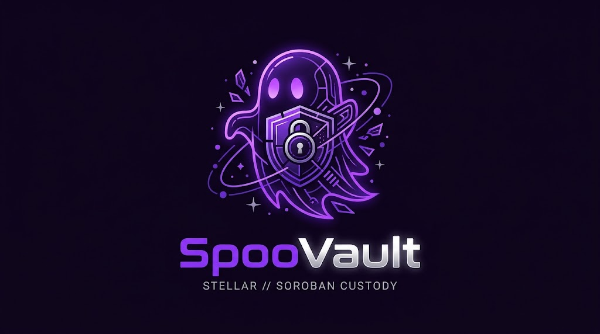

<div align="center">
  <a href="https://spoovault.web.app">
    
  </a>
  <br /><br />
  <h1>SpooVault 🔐</h1>
  <p><strong>The Next-Generation Trustless Document Custody & Dead Man's Switch Protocol on Stellar & Soroban</strong></p>

[](LICENSE)
[](https://react.dev/)
[](https://stellar.org/)
[](https://soroban.stellar.org/)
[](https://vitest.dev/)
[](https://stellar.expert/explorer/testnet/contract/CABUBCKYGVLEOBKW5MQ2Q76IOR3NQSYZLPEUP3JDDX5MFHJDAVM7Y26B)
[](https://drips.network)
</div>

<br />

## 📖 Executive Summary

**SpooVault** is an autonomous, decentralized Web3 document custody and inheritance protocol natively engineered on the **Stellar Network** utilizing **Soroban Smart Contracts**. It revolutionizes digital legacy preservation and sensitive document safeguarding by eliminating custodial counterparty risk, single-point-of-failure key loss, and opaque probate delays through automated on-chain Dead Man's Switch logic, Shamir's Secret Sharing (SSS) multi-guardian consensus, and zero-knowledge client-side encryption.

By leveraging Stellar's 5-second ledger finality, fractions-of-a-cent fees, and Protocol 22 architecture, SpooVault guarantees that critical credentials, private keys, wills, and corporate governance secrets remain impenetrable while alive, yet reliably transition to designated beneficiaries if an owner's heartbeat lapses.

---

## 🌐 Live Stellar Testnet Deployment

| Resource | Value / Direct Link |
| :--- | :--- |
| **Network** | Stellar Testnet (Protocol 22) |
| **Contract ID** | [`CABUBCKYGVLEOBKW5MQ2Q76IOR3NQSYZLPEUP3JDDX5MFHJDAVM7Y26B`](https://stellar.expert/explorer/testnet/contract/CABUBCKYGVLEOBKW5MQ2Q76IOR3NQSYZLPEUP3JDDX5MFHJDAVM7Y26B) |
| **Stellar Expert Explorer** | [View Live Contract on Stellar Expert](https://stellar.expert/explorer/testnet/contract/CABUBCKYGVLEOBKW5MQ2Q76IOR3NQSYZLPEUP3JDDX5MFHJDAVM7Y26B) |
| **Public Docs Portal** | [https://spoovault.web.app/docs](https://spoovault.web.app/docs) |
| **Production Web App** | [https://spoovault.web.app](https://spoovault.web.app) |

---

## 🏗️ System Architecture

```mermaid
graph TD
    A[Vault Creator / Owner] -->|1. Client-Side ECIES AES-GCM Encrypt| B(Pinata IPFS Decentralized Storage)
    A -->|2. Deploy Vault & Timeout on Stellar| C(Soroban Dead Man's Switch Contract)
    D[Authorized Automation Keeper] -.->|3. Relay Heartbeat prove_life| C
    A -->|4. Split Decryption Key via SSS| E[(k, n) Trusted Guardians]
    C -->|5. Heartbeat Lapses / Inactivity Expiration| F[Emergency Release Mode]
    E -->|6. Threshold Shard Approval| C
    C -->|7. Access Pass Verification & Decryption| G[Beneficiary Inheritance Portal]
```

### Core Technology Stack

- **Frontend Framework:** React 18, TypeScript 5.8, Vite, Tailwind CSS, HeroUI, Framer Motion, Lucide & React Icons.
- **Web3 Engine:**
  - **Stellar SDK:** `@stellar/stellar-sdk` (v17.4.0) for Soroban RPC simulation, fee estimation, XDR parsing, and transaction submission.
  - **Freighter API:** `@stellar/freighter-api` for desktop browser extension signing.
  - **Albedo Protocol:** Native web popup bridge for zero-install mobile wallet signing.
  - **WebAuthn / Passkeys:** Hardware biometric key isolation (TouchID, FaceID, Windows Hello, YubiKey).
- **Smart Contracts:** Soroban Rust (`#![no_std]`), persistent storage escrows with automatic Time-To-Live (TTL) rent extension bumping.
- **Decentralized Storage:** IPFS (Pinata) with Private Information Retrieval (PIR) circuit-breaker gateway pooling.
- **Cryptographic Primitives:** ECIES Secp256k1 & Ed25519 payload encryption, Shamir's Secret Sharing (SSS) `(k, n)` polynomial threshold recovery, Argon2id memory-hard password derivation, and OPAQUE PIN verification (RFC 9807).

---

## 🌐 Universal Multi-Wallet Architecture

SpooVault features a native, zero-friction multi-wallet authentication layer supporting both desktop and mobile environments:

| Wallet | Type | Target Environment | Key Feature |
| :--- | :--- | :--- | :--- |
| **Freighter** | Browser Extension | Desktop (Chrome, Brave, Firefox) | Official Stellar Development Foundation wallet. |
| **Albedo** | Web Popup Bridge | Mobile (iOS Safari & Android Chrome) + Desktop | **Zero installation required.** Direct on-chain signing via web popup. |
| **WebAuthn Passkeys** | Hardware Biometrics | Mobile & Desktop | Device-bound biometric keys eliminating seed phrase loss vulnerabilities. |
| **Demo Sandbox** | 1-Tap Sandbox | Any Browser | Pre-funded with **10,000 testnet XLM** for instant zero-setup evaluation. |
| **Watch Mode** | Read-Only Key | Any Browser | Enter any Stellar public key (`G...`) to inspect vaults and heartbeat telemetry. |

---

## 📱 Mobile & Tablet Responsive Design

The interface is engineered with a mobile-first philosophy:

- **Touch Navigation Drawer:** Replaces desktop sidebars on viewports `< 1024px` with a sticky mobile header and animated slide-down navigation.
- **Adaptive HUD:** Displays live Stellar network status, compact address pills (`G...4xyz`), active wallet connector type, and real-time XLM balances.
- **Inactivity Session Lock Gate:** Automatically scrubs private keys from active memory after 15 minutes of inactivity to protect against physical terminal eavesdropping.

---

## 🎯 Role-Based Command Centers (RBAC)

SpooVault organizes platform features into dedicated personas:

### 1. 📢 Vault Creator / Owner Pro
- **Deploy Smart Vaults:** Create on-chain Soroban custody vaults with configurable heartbeat intervals (e.g., 30 days, 90 days, 1 year).
- **Zero-Knowledge Document Encapsulation:** Encrypt documents client-side using AES-256-GCM before writing IPFS hashes to the Stellar ledger.
- **Delegate Keeper Relays:** Authorize automated background relayers to submit `prove_life()` without giving keepers access to vault content.
- **Vault Analytics:** Monitor live heartbeat countdowns, guardian acceptances, and ledger TTL health.

### 2. 🤝 Trusted Guardian Multi-Sig
- **Guardian Acceptance:** Accept cryptographic invitations on-chain and register public recovery keys.
- **Threshold Shard Approvals:** Hold Shamir's Secret Sharing polynomial shards and cryptographically vote to authorize emergency access upon verified owner demise.
- **BLS Signature Aggregation:** Aggregate guardian signatures into compact cryptographic proofs.

### 3. 🔍 Beneficiary Inheritance Portal
- **Claim Inheritance:** Submit access requests to mature vaults once the owner's inactivity timer lapses.
- **In-Browser Decryption:** Reassemble Shamir's shards in-browser to download and decrypt high-value digital assets, wills, and private keys.
- **NFT Access Passes:** Tokenized authorization credentials proving rightful beneficiary ownership on Stellar.

---

## 🚀 Quick Start Guide

### Prerequisites
- **Node.js:** v18.0.0 or higher (v20+ or v24+ recommended)
- **npm:** v10.0.0 or higher
- **Stellar Wallet:** [Freighter](https://www.freighter.app/) (Desktop) or [Albedo](https://albedo.link/) (Mobile / Web)

### 1. Clone & Install
```bash
git clone https://github.com/spoo-vault/spoovault.git
cd spoovault
npm install --legacy-peer-deps
```

### 2. Configure Environment
Create or verify `.env` in the project root:
```env
VITE_STELLAR_NETWORK=TESTNET
VITE_STELLAR_HORIZON_URL=https://horizon-testnet.stellar.org
VITE_STELLAR_SOROBAN_RPC_URL=https://soroban-testnet.stellar.org
VITE_STELLAR_NETWORK_PASSPHRASE="Test SDF Network ; September 2015"
VITE_STELLAR_CONTRACT_ADDRESS=CABUBCKYGVLEOBKW5MQ2Q76IOR3NQSYZLPEUP3JDDX5MFHJDAVM7Y26B
VITE_CONTRACT_ADDRESS=CABUBCKYGVLEOBKW5MQ2Q76IOR3NQSYZLPEUP3JDDX5MFHJDAVM7Y26B
```

### 3. Start Local Development
```bash
npm run dev
```
Visit `http://localhost:5173` to launch the application.

### 4. Running with Docker
```bash
# Build the production container
docker build -t spoovault-frontend .

# Run the container
docker run -p 5173:5173 spoovault-frontend
```

---

## 🧪 Testing & Validation

SpooVault maintains strict software reliability with automated unit testing and full-contract validation:

```bash
# 1. Run all 94 Soroban Rust Smart Contract Tests (including 10,000-state invariant fuzzing)
npm run test:stellar

# 2. Run all 70 Frontend Vitest Suites (918 Passing Tests)
npm test -- --run

# 3. Run Live Stellar Testnet Smoke Check
npm run test:smoke

# 4. TypeScript Typecheck & Production Bundle Check
npx tsc --noEmit
npm run build
```

---

## 🔌 Automated Keeper & Proof-of-Life Relay

The SpooVault Keeper Relayer allows creators to maintain an unbroken proof-of-life signal without continuous manual wallet signing. See the [Keeper Relay Architecture Documentation](docs/HEARTBEAT_RELAYER.md) for authorization specifications, security nonces, and automated cron setups.

---

## 📁 Repository Directory Structure

```
spoovault/
├── .github/                 # GitHub issue templates, workflows, & community standards
│   ├── ISSUE_TEMPLATE/      # Bug reports, feature proposals, and Soroban contract tasks
│   └── PULL_REQUEST_TEMPLATE.md
├── contracts-stellar/       # Native Stellar Soroban smart contracts (Rust)
│   ├── src/
│   │   ├── lib.rs           # Core Dead Man's Switch, Vaults, and Access Control
│   │   ├── test.rs          # 84 Soroban unit & integration tests
│   │   └── fuzz_test.rs     # Invariant property fuzzing
│   ├── tests/               # Emergency unlock multi-ledger delay tests
│   └── Cargo.toml
├── public/                  # Static assets, cyber-ghost logo, icons, manifest
├── scripts/
│   ├── deploy-stellar.mjs   # Stellar Soroban Testnet deployment script
│   ├── optimize-wasm.mjs    # WASM bytecode normalizer & Binaryen optimizer
│   ├── test-stellar.mjs     # Rust test runner
│   └── smoke-check.mjs      # On-chain testnet connectivity verification
├── src/
│   ├── components/          # Modular component library & HeroUI elements
│   ├── context/             # Web3Context (Stellar SDK & Freighter integration)
│   ├── hooks/               # useSessionLock, useOffline, useVaults
│   ├── layouts/             # AppLayout (aligned icon rail & slide panels)
│   ├── pages/               # LandingPage, Dashboard, Vaults, Documents, AccessCenter, DocsPage
│   ├── services/            # stellar.service, contract.service, ipfs.service, sessionLock
│   └── utils/               # ECIES encryption, Shamir Secret Sharing, Argon2id
├── docs/                    # Architecture deep dives & GrantFox contributor issues
├── CONTRIBUTING.md          # Contribution guidelines
├── CODE_OF_CONDUCT.md       # Contributor Covenant Code of Conduct
├── SECURITY.md              # Vulnerability reporting protocol
└── LICENSE                  # MIT License
```

---

## 🌐 Official Channels & Community

Stay connected with our official channels and join our community:

- **Live Application:** [https://spoovault.web.app](https://spoovault.web.app)
- **Public Documentation Hub:** [https://spoovault.web.app/docs](https://spoovault.web.app/docs)
- **Stellar Contract Explorer:** [CABUBCKYGVLEOBKW5MQ2Q76IOR3NQSYZLPEUP3JDDX5MFHJDAVM7Y26B](https://stellar.expert/explorer/testnet/contract/CABUBCKYGVLEOBKW5MQ2Q76IOR3NQSYZLPEUP3JDDX5MFHJDAVM7Y26B)
- **Official GitHub:** [https://github.com/spoo-vault/spoovault](https://github.com/spoo-vault/spoovault)
- **Maintainer Mirror:** [https://github.com/bamiebot-maker/spoovault](https://github.com/bamiebot-maker/spoovault)
- **Founder Profile:** [https://x.com/bamietech_dev](https://x.com/bamietech_dev) (`@bamietech_dev`)
- **Drips Wave Profile:** [https://drips.network](https://drips.network)

---

## 👥 Leadership & Core Maintainers

| Avatar | Name / Role | GitHub | Contact / Social |
| :---: | :---: | :---: | :---: |
|  | **Ibrahim Sobur Bamidele**<br/>_Founder, Lead Full-Stack & Smart Contract Developer_ | [@bamiebot-maker](https://github.com/bamiebot-maker) | [X (Twitter)](https://x.com/bamietech_dev) • [GitHub](https://github.com/bamiebot-maker) |

---

## 🤝 Contributing

We welcome community contributions! Please review [CONTRIBUTING.md](CONTRIBUTING.md) and [SECURITY.md](SECURITY.md) before submitting pull requests.

> 🚨 **IMPORTANT**: All Pull Requests **must target the `dev` branch** (`origin/dev`). The `main` branch is strictly reserved for stable production releases. PRs targeting `main` will be closed with a request to re-target `dev`.

---

## 📄 License

This project is open-source software licensed under the **[MIT License](LICENSE)**.
